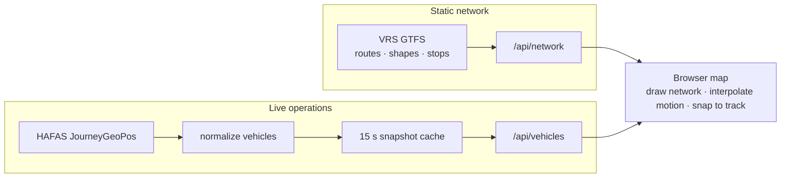

# Cologne Tram Live Map

A minimal live map for Cologne's tram/light-rail network. It combines live vehicle data with static network geometry and keeps the interface intentionally simple: open it, see where the trams are.

<p align="center"></p>

## How it works

The application separates **live operations** from the **static network**:



**GTFS defines where the network is; HAFAS supplies the current vehicle state.**  
The Python backend normalizes and caches both sides, then exposes processed data to the browser through small application endpoints. The frontend combines them to draw the network, interpolate movement between snapshots and align vehicles with plausible track geometry.

This split keeps the browser lightweight and prevents every page refresh from turning into a new upstream request.

## Features

- live tram positions, direction and delay state
- smooth movement between snapshots
- track snapping and stop-aware interpolation
- line filters and Cologne district views
- responsive desktop/mobile layout
- compact diagnostics for live state and snapshot freshness

## Runtime and safety

Live HAFAS data is cached server-side for 15 seconds. Forced refreshes are also rate-limited.

A fail-closed circuit breaker monitors request volume. If a configured threshold is exceeded, the application continues serving the latest cached snapshot but stops contacting HAFAS until the process is restarted.

The HAFAS access identifier is supplied through `COLOGNE_TRAM_HAFAS_AID` and is never stored in the repository.

## Run locally

Requires Python 3.11+.

```bash
git clone https://github.com/vinyz32/cologne-tram-live-map.git
cd cologne-tram-live-map

python -m venv .venv
source .venv/bin/activate
pip install -e .

export COLOGNE_TRAM_HAFAS_AID="..."
cologne-tram-live-map
```

Open `http://127.0.0.1:8000`.

## Deployment

The public demo runs as a single Railway service. The app automatically uses Railway's injected `PORT`, provides `/healthz` for readiness checks and keeps only one replica to avoid multiplying upstream polling.

The same application can also run continuously as a systemd service on a Raspberry Pi.

## Data sources

- **Live data:** experimental HAFAS `JourneyGeoPos` integration
- **Network:** VRS GTFS routes, shapes and stops
- **Basemap:** OpenFreeMap / OpenMapTiles / OpenStreetMap

Third-party notices and licensing details are listed in [THIRD_PARTY_NOTICES.md](THIRD_PARTY_NOTICES.md).

> **Note:** This is an independent non-commercial hobby project. Vehicle positions are operational estimates and may be delayed, incomplete or inaccurate. Do not rely on this map as authoritative passenger information; check official transport information before travelling.
