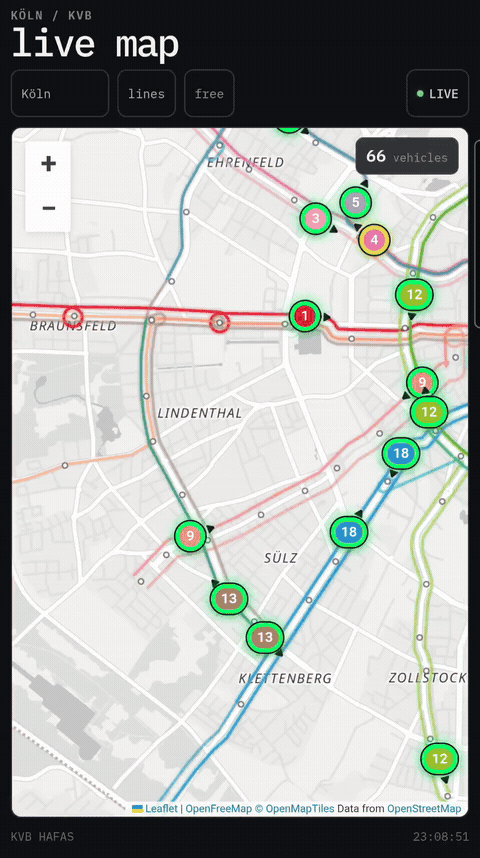
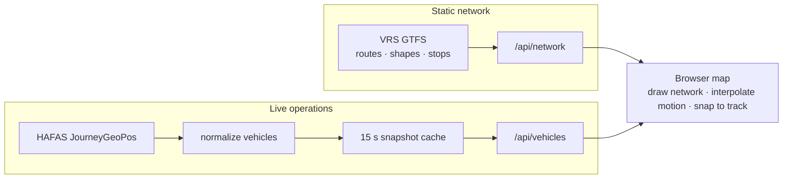

# Cologne Tram Live Map

A minimal live map for Cologne's tram/light-rail network. It combines live vehicle data with static network geometry and keeps the interface intentionally simple: open it, see where the trams are.

<p align="center"></p>

## How it works

The application separates **live operations** from the **static network**:



**GTFS defines where the network is; HAFAS supplies the current vehicle state.**  
The backend normalizes and caches both sources, then serves processed data to the browser through small application endpoints. The frontend combines both streams to draw the network, interpolate movement between snapshots and align vehicles with plausible track geometry.

## Features

- live tram positions, direction and delay state
- smooth movement between snapshots
- track snapping and stop-aware interpolation
- line filters and Cologne district views
- responsive desktop/mobile layout
- compact live-state diagnostics

## Run locally

Requires Python 3.11+.

A valid HAFAS access identifier is required for live vehicle data and is not included in this repository.

```bash
git clone https://github.com/vinyz32/cologne-tram-live-map.git
cd cologne-tram-live-map

python -m venv .venv
source .venv/bin/activate
pip install -e .

export COLOGNE_TRAM_HAFAS_AID="..."
cologne-tram-live-map
```

Open `http://127.0.0.1:8000`.

## Deployment

The public demo is deployed as a small Railway service.

## Data sources

- **Live data:** experimental HAFAS `JourneyGeoPos` integration
- **Network:** VRS GTFS routes, shapes and stops
- **Basemap:** OpenFreeMap / OpenMapTiles / OpenStreetMap

Third-party notices and licensing details are listed in [THIRD_PARTY_NOTICES.md](THIRD_PARTY_NOTICES.md).

> **Note:** This is an independent non-commercial hobby project. Vehicle positions are operational estimates and may be delayed, incomplete or inaccurate. Do not rely on this map as authoritative passenger information; check official transport information before travelling.
